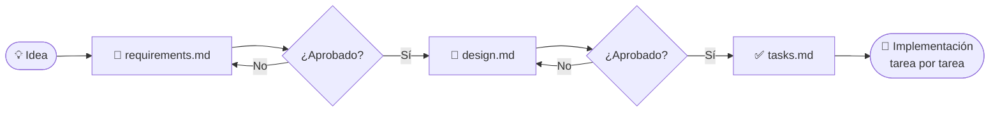

<div align="center">

# 📐 Spec-Driven Development · Plantillas en español

**Primero la spec, después el código.**

Tres plantillas para que tu agente de IA deje de adivinar y empiece a construir lo que realmente necesitás.


</div>

---

## 🤔 ¿Qué es Spec-Driven Development?

Hoy cualquiera le pide a una IA que escriba código y en cinco minutos tiene algo funcionando. El problema aparece después: cuando hay que cambiarlo, explicarlo o entender por qué hace lo que hace.

**Spec-Driven Development invierte el orden.** Antes de escribir una línea de código se escribe la especificación: qué hay que resolver, para quién, qué casos raros pueden aparecer y cuándo lo damos por terminado. Esa spec pasa a ser la **fuente de verdad**, y el código (lo escriba una persona o un agente) sale de ahí.

| Sin spec 😅 | Con spec 🎯 |
|---|---|
| La IA completa los huecos con suposiciones | La IA ejecuta sobre algo acordado |
| Las discusiones aparecen cuando el código ya está hecho | Las discusiones se dan cuando cambiar de idea todavía es gratis |
| Para entender el proyecto hay que leer el código | Para entender el proyecto alcanza con leer una página |
| "Terminado" significa "parece que anda" | "Terminado" significa que cada criterio se verificó |

---

## 🗂️ Las tres plantillas

| | Archivo | Responde a | Contenido |
|:-:|---|---|---|
| **1** | [`requirements.md`](./requirements.md) | **¿Qué?** | Historias de usuario, criterios de aceptación en notación EARS, alcance y preguntas abiertas |
| **2** | [`design.md`](./design.md) | **¿Cómo?** | Arquitectura, componentes, modelo de datos, manejo de errores, decisiones y estrategia de pruebas |
| **3** | [`tasks.md`](./tasks.md) | **¿En qué orden?** | Tareas chicas y verificables, con dependencias y trazabilidad hacia cada requerimiento |

### 🔁 El flujo



> [!IMPORTANT]
> **Cada archivo se revisa y se aprueba antes de pasar al siguiente.** Un error en los requerimientos lo heredan el diseño y las tareas: corregirlo ahí cuesta minutos; corregirlo en el código, días.

---

## 🚀 Cómo usarlas

### Paso 0 · Copiá las plantillas a tu proyecto

Creá una carpeta por funcionalidad y copiá los tres archivos adentro:

```bash
mkdir -p specs/mi-funcionalidad
cp requirements.md design.md tasks.md specs/mi-funcionalidad/
```

```
mi-proyecto/
└── specs/
    └── mi-funcionalidad/
        ├── requirements.md
        ├── design.md
        └── tasks.md
```

### Paso 1 · 📄 Requerimientos: el qué

Completá `requirements.md`. Es el documento más importante, así que dedicale el tiempo que necesite.

- Describí el problema y para quién es.
- Dejá por escrito qué queda **fuera de alcance**. Evita que el proyecto crezca sin control.
- Escribí cada criterio de aceptación con la **notación EARS** (ver el machete más abajo).
- Anotá las preguntas abiertas con un responsable. Ninguna duda debería terminar convertida en una suposición del desarrollador.

> [!TIP]
> Si un criterio no se puede verificar con una prueba o un chequeo manual, todavía no es un requerimiento. Cambiá "rápido" por "en menos de 2 segundos" y "fácil" por "en 3 toques o menos".

### Paso 2 · 📐 Diseño: el cómo

Con los requerimientos aprobados, completá `design.md`:

- Indicá qué requerimientos cubre el diseño (**R1, R2, …**). Si alguno no tiene diseño, hay un hueco; si una parte del diseño no responde a ningún requerimiento, sobra.
- Dibujá la arquitectura. La plantilla trae diagramas en Mermaid que GitHub muestra automáticamente.
- Registrá las decisiones importantes y por qué las tomaste, así no se vuelven a discutir dentro de seis meses.

### Paso 3 · ✅ Tareas: el paso a paso

Con el diseño aprobado, dividí el trabajo en `tasks.md`:

- Cada tarea tiene que poder terminarse y verificarse en una sola sesión.
- Cada tarea indica qué requerimientos cumple y de qué otras tareas depende.
- Cada tarea tiene un **"Terminada cuando"** concreto. "Se ve bien" no cuenta.
- Usá la tabla de cobertura del final para confirmar que ningún requerimiento quedó sin tarea.

### Paso 4 · 🤖 Implementá con tu agente de IA

Pasale los tres archivos al agente y pedile que avance **una tarea a la vez**, marcando cada una como terminada.

---

## 🛠️ Uso con herramientas de IA

<details>
<summary><b>🟣 Kiro</b></summary>

<br>

Kiro trabaja con specs de forma nativa y espera exactamente estos tres archivos. Guardalos en:

```
.kiro/specs/<nombre-de-la-funcionalidad>/
├── requirements.md
├── design.md
└── tasks.md
```

Desde ahí podés pedirle a Kiro que te ayude a completar cada documento y, una vez aprobados, ejecutar las tareas de `tasks.md` una por una desde el propio archivo.

</details>

<details>
<summary><b>🟠 Claude Code</b></summary>

<br>

Guardá los archivos en cualquier carpeta del repo (por ejemplo `specs/<nombre-de-la-funcionalidad>/`) y trabajá en etapas. Algunos prompts para arrancar:

**Para completar los requerimientos:**
```text
Leé specs/mi-funcionalidad/requirements.md. Quiero construir <descripción>.
Ayudame a completar la plantilla y haceme preguntas sobre todo lo que no esté claro.
No escribas código todavía.
```

**Para el diseño:**
```text
Con base en specs/mi-funcionalidad/requirements.md (ya aprobado) y en el código
actual del repo, completá specs/mi-funcionalidad/design.md.
```

**Para las tareas:**
```text
Con requirements.md y design.md aprobados, completá specs/mi-funcionalidad/tasks.md
con tareas chicas, ordenadas por dependencia y con un chequeo de terminado concreto.
```

**Para implementar:**
```text
Implementá la tarea 1 de specs/mi-funcionalidad/tasks.md. Cuando el chequeo de
"Terminada cuando" se cumpla, marcala como [x] y frená para que la revise.
```

> [!TIP]
> Usá el **modo plan** de Claude Code para revisar el enfoque antes de que toque código, y sumá una línea en tu `CLAUDE.md` indicando dónde están las specs del proyecto.

</details>

<details>
<summary><b>⚪ Otras herramientas</b></summary>

<br>

Las plantillas son Markdown plano, así que funcionan con cualquier agente o asistente (Cursor, GitHub Copilot, Windsurf, etc.). La clave es la misma: dale la spec como contexto y pedile que avance de a una tarea.

</details>

---

## 📝 Machete de notación EARS

Los criterios de aceptación de `requirements.md` usan **EARS** (*Easy Approach to Requirements Syntax*), una forma de escribir requerimientos con una sola lectura posible.

| Tipo | Forma | Cuándo usarla |
|---|---|---|
| **Ubicuo** | `EL SISTEMA DEBERÁ <respuesta>` | Algo que se cumple siempre |
| **Por evento** | `CUANDO <disparador>, EL SISTEMA DEBERÁ <respuesta>` | Reacción a un evento |
| **Por estado** | `MIENTRAS <estado>, EL SISTEMA DEBERÁ <respuesta>` | Se cumple durante un estado |
| **No deseado** | `SI <condición>, ENTONCES EL SISTEMA DEBERÁ <respuesta>` | Errores y casos borde |
| **Opcional** | `DONDE <funcionalidad>, EL SISTEMA DEBERÁ <respuesta>` | Detrás de un flag o una configuración |

**Ejemplo:**

```text
CUANDO el usuario ingresa una contraseña incorrecta 3 veces seguidas,
EL SISTEMA DEBERÁ bloquear la cuenta durante 15 minutos y avisarle por email.
```

> [!NOTE]
> En inglés las palabras clave son `WHEN`, `WHILE`, `IF … THEN`, `WHERE` y `THE SYSTEM SHALL`. Si tu equipo o tu herramienta trabaja en inglés, podés usarlas sin cambiar nada más.

---

## 💡 Consejos

- **Arrancá con algo chico.** Elegí una funcionalidad que se pueda terminar en pocos días para probar el método.
- **Una spec buena puede ser una página.** No se trata de escribir mucho, sino de no dejar nada ambiguo.
- **Las specs se actualizan.** Si algo cambia durante la implementación, primero se cambia la spec y después el código.
- **Versioná las specs junto al código.** Así cualquiera puede ver qué se pidió, qué se decidió y por qué.

---

## ❓ Preguntas frecuentes

<details>
<summary><b>¿No es volver a la documentación pesada de antes?</b></summary>

<br>

No. La idea no es escribir documentos largos que nadie lee, sino dejar claro qué se va a construir antes de construirlo. Además, ahora esa spec no queda en un cajón: es lo que le da las instrucciones a la IA.

</details>

<details>
<summary><b>¿Tengo que completar todas las secciones?</b></summary>

<br>

No. Las secciones marcadas como opcionales se pueden saltear si no aportan. Lo que no conviene saltear son los criterios de aceptación, el alcance y el "Terminada cuando" de cada tarea.

</details>

<details>
<summary><b>¿Sirve para proyectos que ya están en marcha?</b></summary>

<br>

Sí. Usá las plantillas para la próxima funcionalidad o el próximo cambio grande. No hace falta documentar todo lo que ya existe.

</details>

---

<div align="center">

**¿Lo probaste?** Contanos cómo te fue o proponé mejoras abriendo un *issue* o un *pull request*. ⭐ Si te sirvió, dejale una estrella al repo.

</div>
