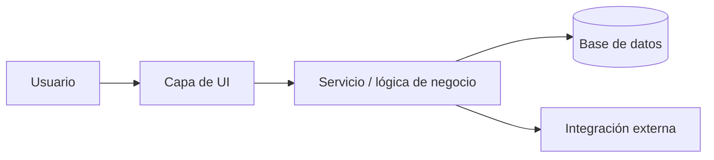
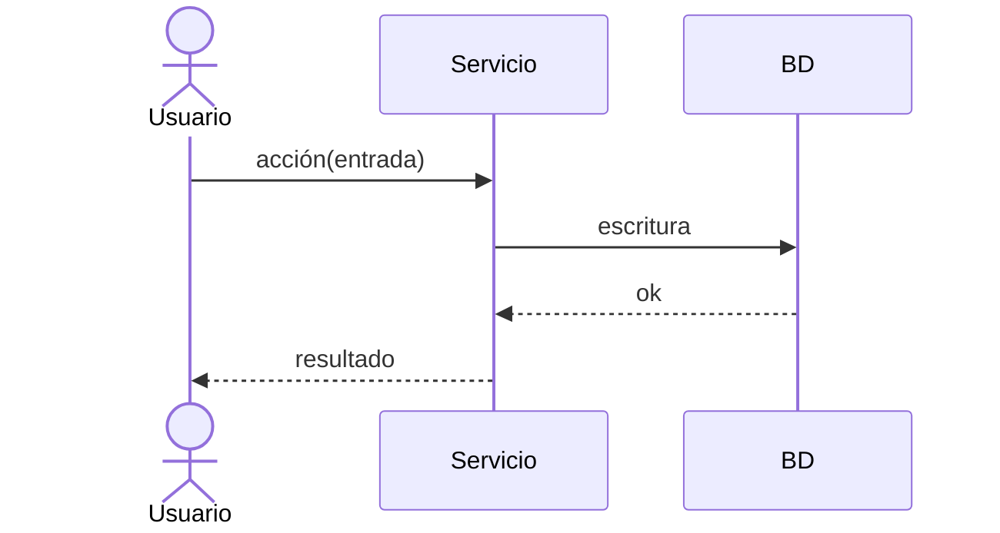

# Diseño — <Nombre de la funcionalidad / proyecto>

> Traduce el "qué" (requerimientos) en el "cómo". Tiene que basarse en el stack real,
> el modelo de datos y el código existente, no en patrones inventados.
> Revisá y aprobá este archivo ANTES de dividir el trabajo en tareas.

## Resumen

<2 a 4 oraciones: el enfoque técnico a alto nivel. ¿Qué forma tiene la solución
y por qué esa forma?>

**Requerimientos cubiertos:** R1, R2, R3, ... (listá los IDs de requerimientos que cubre este diseño.
Si un requerimiento no tiene diseño, hay un hueco. Si una parte del diseño no responde a ningún requerimiento, sacala.)

## Arquitectura

<Cómo encajan las piezas. Para esto un diagrama vale más que un texto: un flujo simple
o un diagrama de componentes muestra de un vistazo el recorrido de los datos y los límites.>



## Componentes y responsabilidades

Para cada componente: de qué se encarga, de qué depende y cuál es su interfaz principal.

### <Componente A>
- **Responsabilidad:** <una única tarea clara>
- **Depende de:** <otros componentes / librerías>
- **Interfaz:**
  ```ts
  // la(s) firma(s) que usa el resto del código: lo suficiente para fijar el contrato
  function hacerAlgo(entrada: TipoEntrada): Promise<Resultado>
  ```

### <Componente B>
- **Responsabilidad:** ...
- **Depende de:** ...
- **Interfaz:** ...

## Modelo de datos

<Tablas / tipos / esquemas nuevos o modificados. Mostrá campos, tipos, claves y restricciones.
Marcá todo lo que tenga invariantes: montos en centavos como enteros, fechas en UTC, etc.>

```
<nombre_tabla>
  id            <tipo, clave>
  <campo>       <tipo, restricciones>
  ...
```

## Flujo de datos / secuencias (opcional)

Para los flujos no triviales, un diagrama de secuencia deja explícitos el orden y los caminos de error.



## Manejo de errores

Cómo se informan y se recuperan las fallas. Llevá los casos de error de los criterios
SI/ENTONCES de los requerimientos a un manejo concreto acá.

- **<caso de error>** → <comportamiento: reintento / mensaje al usuario / log / rollback>

## Decisiones de diseño y compromisos

El "por qué". Dejá registradas las decisiones para no volver a discutirlas dentro de seis meses.
Para las decisiones grandes, vale la pena un ADR corto (contexto → decisión → consecuencias).

- **Decisión:** <qué elegiste>. **Por qué:** <motivo>. **Alternativas evaluadas:** <qué descartaste y por qué>.

## Estrategia de pruebas

Cómo vas a demostrar que se cumplen los requerimientos. Vinculá cada tipo de prueba con los IDs de requerimientos.

- **Unitarias:** <lógica pura, p. ej. cálculos de montos, manejo de fechas>
- **De integración:** <servicios contra una base real o en memoria>
- **End-to-end:** <flujos críticos del usuario: listalos>

## Riesgos / incógnitas

Riesgos técnicos que podrían cambiar el plan. Si son graves, investigalos con una prueba de concepto antes de comprometerte.

- <riesgo> — mitigación: <cómo reducirías el riesgo>
